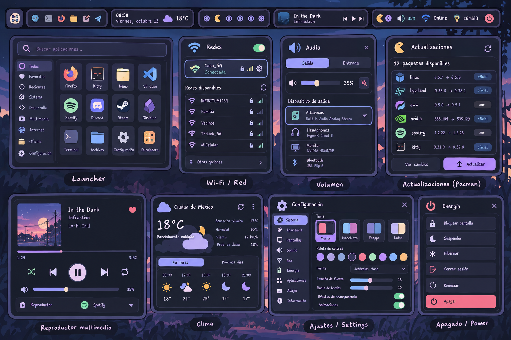

# hyprland-desktop

Entorno de escritorio modular para **Hyprland 0.56+** con **Eww**, tema **Catppuccin** y
diseño basado en `docs/references/mockup.png` (barra de cápsulas inspirada en el rice
*Andrea* de [gh0stzk](https://github.com/gh0stzk/dotfiles)). Pensado para Arch Linux.



## Qué incluye

| Componente | Descripción |
|---|---|
| Barra | Una por monitor: lanzador y accesos rápidos · fecha y clima · espacios de trabajo · reproductor · actualizaciones, micrófono, volumen, batería, red, usuario y energía |
| Lanzador | Búsqueda mientras escribes, categorías, favoritas, recientes, navegación por teclado |
| Configuración | Sistema, apariencia (selector de temas/fuentes), pantallas, sonido, red, energía, aplicaciones, atajos, servicios |
| Paneles | Wi-Fi/red, audio, actualizaciones (pacman + AUR), reproductor, clima, calendario, energía |
| Temas | Catppuccin Mocha (predeterminado), Macchiato, Frappé, Latte y Monocromático; cambio en vivo y persistente |
| Hyprland | Configuración Lua modular, dos monitores, atajos heredados de AwesomeWM, hyprlock/hypridle |

## Instalación rápida

```sh
git clone <este repositorio> ~/Documentos/hyprland/hyprland-desktop
cd ~/Documentos/hyprland/hyprland-desktop
./install.sh --dry-run   # ver qué haría
./install.sh             # instalar (pide confirmación en cada paso)
```

Después cierra sesión y elige **Hyprland** en el gestor de inicio de sesión.
Detalles: [docs/installation.md](docs/installation.md).

## Uso diario

```sh
desktopctl apply                         # regenerar tras editar settings.json
desktopctl appearance set theme latte    # cambiar de tema
desktopctl popup toggle launcher         # abrir el lanzador
desktopctl doctor                        # comprobar dependencias y servicios
desktopctl get audio                     # ver el estado que reciben los widgets
```

Atajos principales: `Super+Return` terminal · `Super+R` lanzador · `Super+W` configuración ·
`Super+Shift+T` temas · `Super+Shift+Q` energía · `Super+S` lista de atajos.
Lista completa: [docs/keybindings.md](docs/keybindings.md).

## Arquitectura

```
settings.json ─┐                    ┌─> config/eww/styles/tokens/_generated.scss
themes/*.json ─┴─> desktopctl apply ┼─> config/hypr/generated/{settings,theme}.lua
                                    └─> hyprlock.conf · hypridle.conf · kitty

compositor ─┐
PipeWire ───┤                         sockets por tema              ┌─ barra (monitor 1)
NetworkMgr ─┼─> desktopd (Python) ──> $XDG_RUNTIME_DIR/… ──> Eww ──┼─ barra (monitor 2)
MPRIS ──────┤   controlador central    (deflisten)                  └─ popups
pacman/clima┘   + gestor de popups
```

- **Un archivo para personalizar:** `~/.config/hyprland-desktop/settings.json`.
- **Un controlador de estado:** `desktopd` escucha eventos (socket de Hyprland, `pactl subscribe`,
  `nmcli monitor`, `playerctl --follow`) y publica un JSON por dominio. Eww se suscribe una vez
  por dominio, sin importar cuántas barras haya; los widgets no consultan el sistema.
- **Un gestor de popups:** un solo popup abierto, en el monitor desde el que se pulsó, con cierre
  por clic fuera y por Escape.
- **Portable entre compositores:** Eww solo habla con `desktopctl`. Lo específico de Hyprland
  está en `lib/desktop/wm/hyprland.py` (ver [docs/wm-adapters.md](docs/wm-adapters.md)).

```
bin/                 desktopctl (CLI) · desktop-sub (suscripción de Eww)
lib/desktop/         daemon, generador de config (render.py), adaptadores wm/, fuentes sources/
config/hypr/         hyprland.lua + modules/*.lua
config/eww/          vars.yuck · components/ · widgets/<widget>/{.yuck,.scss} · styles/
themes/              paletas
assets/icons/        iconos de la barra (GPL-3.0, gh0stzk)
docs/                guías y referencias visuales
```

## Documentación

- [Instalación y restauración](docs/installation.md)
- [Personalización](docs/customization.md)
- [Atajos de teclado](docs/keybindings.md)
- [Widgets y cómo crear uno nuevo](docs/widgets.md)
- [Crear un tema](docs/themes.md)
- [Portar a otro compositor](docs/wm-adapters.md)
- [Decisiones técnicas y estado de validación](docs/decisions.md)

## Licencia

GPL-3.0 (incluye iconos de gh0stzk/dotfiles, GPL-3.0). Ver `LICENSE` y `assets/icons/NOTICE.md`.
